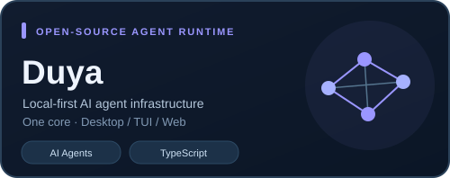

  

  
  
  

  

  Exploring the intersection of <strong>hydrological science</strong>, <strong>AI agents</strong>, and <strong>developer tools</strong>. 
  Currently building <a href="https://github.com/lava-chen/duya"><strong>Duya</strong></a> and researching multi-source precipitation fusion.

### Featured projects

  
  

  
  
  

  More: <a href="https://github.com/lava-chen/FlowPilot">FlowPilot</a> · <a href="https://github.com/lava-chen/ResearchScaffold">ResearchScaffold</a> · <a href="https://github.com/lava-chen?tab=repositories">all repositories</a>

### Toolbox

  

### GitHub pulse

  

  
  

<!-- Profile layout: SVG assets are stored locally; live badges, skill icons, typing animation,
     and streak statistics are provided by external services. GitHub's native contribution
     calendar appears below this README. -->
